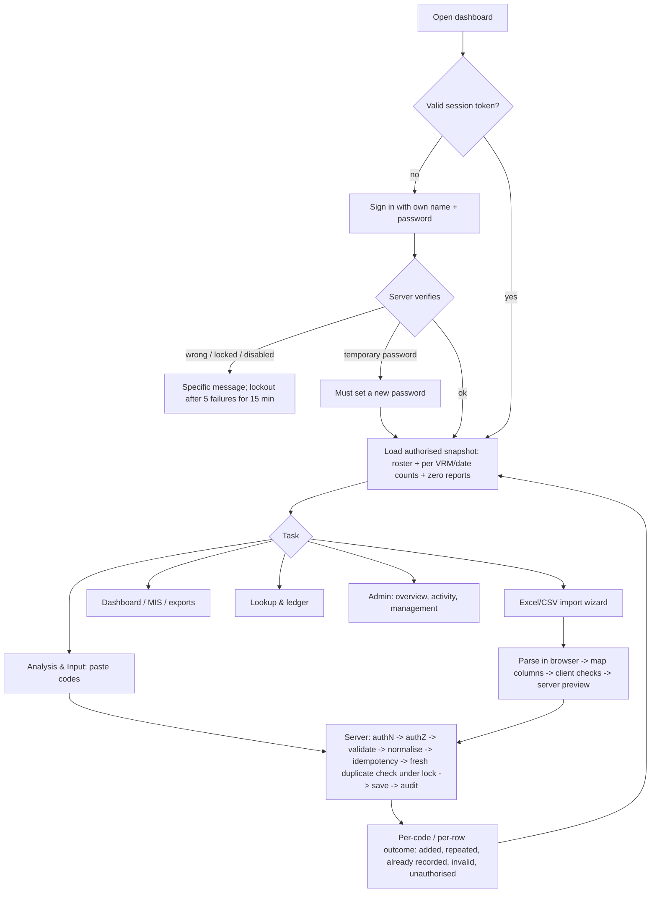

# 01 · Workflow — VRM Account MIS v3

**Business time zone:** Asia/Kolkata (IST). **Data grain:** one distinct accepted client code = one activation record,
attributed to exactly one VRM and one activation date. There is no manual count entry.

## Personas
| Persona | Account | Does |
|---|---|---|
| VRM (member) | Individual, linked to one VRM | Records/imports own activations, files zero reports, reads MIS (team or own scope by config). |
| Admin | Individual, optionally linked to a VRM | All member actions for any VRM; roster, aliases, accounts, corrections, deletes/restores, exceptions, audit. |
| Reviewer | Individual, read-only | Dashboards, MIS, exports, ledger, activity log. |
| System | Apps Script backend | Authenticates, authorises, validates, deduplicates under lock, timestamps (UTC), audits. |

## End-to-end flow

## Daily VRM process
1. Sign in. The server decides role and VRM; a member's VRM is locked on the input screen.
2. **Analysis & Input** → activation date defaults to **today (IST)**; back-dating allowed, future refused.
3. Paste codes separated by commas, semicolons or new lines. Blank pieces are ignored. The live counter shows entered/unique/
   repeated/invalid before saving.
4. **Save** (double-click safe). The result lists every code: *Added*, *Repeated in paste*, *Already recorded* (with the existing
   VRM/date when the role may see it), *Invalid* (with the reason) or *Failed*.
5. If the network drops, the screen says **Not confirmed** and keeps the codes. **Retry safely** re-sends the same request ID;
   the server saves each code at most once (proven in E2E test TC-038).
6. No activations today? **Report zero for this date**. This never adds an activation and is refused if activations exist.

## Import process
1. **Excel / CSV Import** → choose `.xlsx`, `.xls` or `.csv` (≤10 MB). The file is parsed in the browser; only rows are sent.
2. Choose worksheet (when several have data) and layout: *VRM, Date, Client Code columns* or *single column of codes* (VRM and
   date chosen on screen; members are locked to their VRM).
3. Columns auto-map only on documented exact header aliases; otherwise map by hand. Choose the text date format or leave
   *Detect from the file*; ambiguous `NN/NN/YYYY` dates are flagged, never swapped.
4. **Preview**: every row gets a status from the file checks (invalid code, number-formatted code, scientific-notation damage,
   invalid/future/ambiguous date, missing VRM, repeated in file) and from the server (already recorded, unknown/archived VRM,
   not your VRM). Filter by status; download the exception CSV.
5. Unknown VRM names: an admin may tick “Create VRM …” for genuinely new people; otherwise add an alias in Management.
6. **Import**: rows are sent in parts of ≤1,500 with ID `batchId:partIndex` (idempotent). Transient failures retry the same part
   automatically twice, then pause with *Retry part* / *Stop import*. Parts saved before a stop stay saved and are reported.
7. **Results**: reconciliation `file rows = rejected before upload + sent (+ not sent)` and
   `sent = saved + repeated in file + already recorded + invalid + not authorised`, compared with the server's batch register.

## Reporting
- KPIs: Today, This month, This year, All time, Active VRMs (active roster incl. zero performers).
- MIS: Year, Month/Whole year, From/To (inclusive; overrides Year/Month while set; From > To blocks the report with a message),
  Whole team / one VRM; sortable table with Today/Month/Year/All-time (fixed calendar periods) and Selected period + share.
- Exports (Excel: Report/Summary/Detail sheets; CSV: stacked Report, Summary, Detail) use the same filter on the server; the client
  checks the export total against the screen and refreshes if the server has newer data.

## Corrections (admin)
| Situation | Action | Effect |
|---|---|---|
| Wrong VRM or date | Lookup → **Correct** (reason required) | Same entry ID; before/after in audit. |
| Should not count | **Delete** (reason) | Soft delete: excluded from totals, tombstone keeps the code reserved. |
| Deleted in error | **Restore** (reason) | Same record counts again; no second record. |
| VRM name changes | Management → **Rename** | Stable VRM ID; old spelling becomes an alias. |
| VRM leaves | **Archive** (reason) | No new entries; history still counts; linked accounts must be disabled/reassigned first. |
| Person leaves | Users → **Disable** (reason) | All sessions revoked immediately; records untouched. |

## End-of-day checklist (admin)
- Admin Overview: every active VRM is *Filed* or *Confirmed zero*; chase *Not reported* (it is not proof of non-compliance).
- Import exceptions reviewed; corrections and backdated entries reviewed.
- **Run integrity check**: no duplicate code keys, orphans, invalid/future dates; team = sum of VRMs.
- Backups: daily trigger ran (Drive folder) — see runbook §7.
